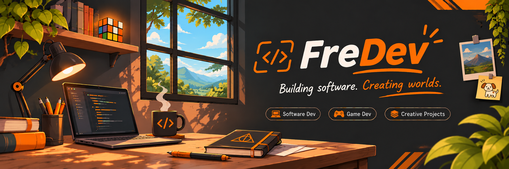

  

Software Engineering student building web apps, digital tools and games. Part of **[Needy Friends](https://needyfriends.pages.dev)**, a small indie studio.

### Projects

- **[Needy Friends](https://needyfriends.pages.dev)**: our studio's website.
- **[Claupier](https://github.com/FredManBA/claupier)**: Claude Code usage as a tiny pixel art casino table. Open source.
- **[retroM](https://retrom.pages.dev)**: a retro virtual office for two.
- **[Costa Rica 360](https://properties.costarica360.workers.dev)**: real estate with 360° panoramas and maps.

**Currently building:** Tornasol (incremental game) · Phosphor (tactical simulator) · Tiny Kingdoms (casual strategy)

### Tech stack

  
  
  
  
  
  
  
  
  
  

  
  
  
  
  
  

  
  
  
  
  
  

  
  
  
  
  

  
  
  
  
  
  

### Find me

  
  
  
  

